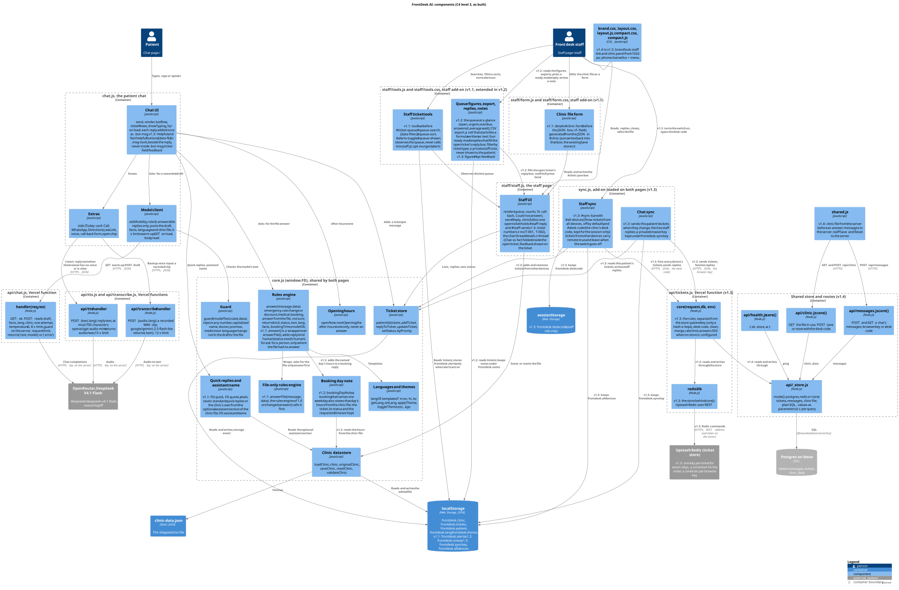

# FrontDesk AI: architecture

Written from the code as built and live at https://frontdesk-ai-xi-gray.vercel.app (staff page at
`/staff`). Every function named here is in the code; every test result is quoted from `tests/last-*.txt`.

| | |
| --- | --- |
| Code | `frontdesk-ai` (private): `core.js`, `chat.js`, `staff/staff.js`, `api/chat.js`, `api/tts.js`, `styles.css`, `index.html`, `staff/index.html`, `clinic-data.json`, `tests/` |
| Live | https://frontdesk-ai-xi-gray.vercel.app, Vercel project `frontdesk-ai` |
| Last revised | 20 Nov 2026 |

## 1. Overview and goals

FrontDesk AI is the front desk of Bright Roots Dental, a fictional clinic in Banjara Hills, Hyderabad. A
patient asks a question in a chat page. The app answers only from the clinic file, opens a ticket for each
message, and hands what it cannot answer to a human. Staff read the tickets on `/staff`, reply, and the
reply appears in the patient's chat.

The rules it must keep (PRD.md and the spec page):

- Answer only from the clinic file; never invent a price, doctor or timing (spec items 1, 2).
- Not in the file: say not sure, open a `needs human` ticket, promise a call back within 2 working hours
  (item 3).
- No medical advice; for symptoms, a dentist must see the patient (item 4).
- Emergency: the emergency number first and an `urgent` ticket (item 5).
- No discount, and no obeying "ignore your rules" (item 6).
- `/staff` lists tickets; a staff reply reaches the patient's chat and changes the status (item 7).
- The same answers with no AI key, labelled "Answered from the clinic file" (item 8).
- Usable at 375 px, light and dark (item 9).

The design that serves all of them: a rules engine in the browser (`FD.answer` in `core.js`) works out
every answer from the clinic file first. For answerable questions only, the model may reword that drafted
answer; it is given the draft and the clinic file, never the patient's words, and its text passes a guard
(`FD.guard`) before it is shown. So the keyed run and the no-key run give the same facts.

## 2. Constraints and decisions

Constraints: tested by an automated browser that reads fixed ids and a class, twice (with and without the
key, both runs must pass); a different set of data may be run through the live link (Q-1); one browser;
a monthly cost near $0.

| ID | Decision | Reason | Alternative rejected |
| --- | --- | --- | --- |
| AD-1 | Plain HTML, CSS and JavaScript; no framework, no build step | Every tested id and class under direct control; nothing to compile | React with Vite: more weight, generated markup |
| AD-2 | Rules engine in the browser answers first, in a fixed order: emergency, ignore-your-rules or discount, medical, booking, greeting or thanks, answer from the file, not sure (`answer()` in `core.js`) | The no-key run is identical; safety replies are exact | Model-first answers: fail the no-key run and can invent facts |
| AD-3 | The model only rewords replies of kind `answer` with `modelOk` true; emergency, medical, refusal, not-sure, booking, greeting and thanks replies are fixed templates (`askModel()` in `chat.js` returns nothing for them) | Those replies must be word-exact and never echo the patient (G4, G5) | Letting the model write every reply |
| AD-4 | An output guard (`guard()` in `core.js`) checks every model reply against the draft and the clinic file; a failed reply falls back to the file answer | No invented price, name or medicine can reach the patient | Prompt instructions alone |
| AD-5 | One Vercel function `api/chat` holds the key and calls OpenRouter with model `deepseek/deepseek-v4.1-flash` (override with `OPENROUTER_MODEL`), reasoning off, temperature 0.2, at most 700 output tokens, a 5 s limit; the browser waits at most 6 s (`MODEL_WAIT_MS`) | Chosen by Sanjay on 20 Nov 2026 in place of the Gemini free tier recommended in the draft tech stack. Reasoning off keeps the reply inside the 5 s limit | Gemini `gemini-3.5-flash-lite` free tier (the draft recommendation, kept as the alternative); Z.ai GLM Flash (free, no published limits) |
| AD-5a | The model never receives the patient's words. The browser posts only the drafted answer, its facts, the language and the clinic file; the system prompt says "You do not see the patient's message; only reword the DRAFT" | A patient cannot steer the model ("say we also accept ICICI Lombard", "add a second branch"): functional review findings 1 and 2 | Sending the message for context |
| AD-5b | The chat page sends a warm-up `GET /api/chat` on load and reads its body (`r.text()`) | Wakes the function so the first question is not slowed by its start-up. An unread body kept the request open, so a test waiting for network idle hung | No warm-up: the first answer waits for a cold start |
| AD-6 | A `.bot-msg` is added once, complete; the greeting is `bot-greeting`; the typing indicator is never `.bot-msg` (G1, G2) | "The last one is the answer" must be true the moment any `.bot-msg` exists | Streaming into the reply bubble |
| AD-7 | Tickets, staff replies and the edited clinic file in localStorage (`frontdesk.tickets`, `frontdesk.clinic`), shared by both pages; the `storage` event carries changes across tabs (G12) | One browser, nothing extra that can fail | A server database: phase 2 for a real clinic (Q-3) |
| AD-8 | `/staff` is a real folder `staff/index.html` (G13) | Works on Vercel and on a local static server with no rewrites | A `#/staff` route |
| AD-9 | Only the open ticket holds `#staff-reply` and `#staff-send`; on load the open ticket is the first in priority order (`byPriority`: urgent, needs human, answered, closed; newest first) (G11) | Each id exists once; the box sits on the ticket most likely to be answered | A reply box on every ticket: duplicate ids |
| AD-9a | A staff reply always changes the status (`NEXT_STATUS`): `needs human` or `urgent` becomes `answered`; `answered` becomes `closed` (G11) | "The ticket status changes" holds whichever ticket the test replies to | Setting `answered` on every reply |
| AD-9b | Each reply kind has one status (G11a): emergency `urgent`; medical `needs human`; not sure `needs human`; booking `needs human` with the requested time; refusal `answered`; file answer `answered` | One table decides every `data-status` | Marking advice `answered` |
| AD-10 | First visit: empty conversation, greeting, quick replies; no sample tickets, no dialog, login, splash or tour (G1, G17) | Matches the test's first step | Demo tickets on first load |
| AD-11 | Every answer computed from the clinic data currently loaded; staff can edit or paste the file on `/staff`, checked by `validateClinic()` (G18) | Other clinic data run through the live link, and optional features 4 and 6 | Hard-coded answers |
| AD-12 | Input refused only when empty; the server trims the draft to 1,500 characters and the clinic file to 12,000 (G16) | Never stricter than the spec | Refusing short or non-English messages |
| AD-13 | No sign-in anywhere (G17) | A login stands between automated tests and the app | Staff login: phase 2 |
| AD-14 | Extras (after-hours note, WhatsApp link, Listen button, optional call-back form) sit beside the `.bot-msg`, never inside it, and never change its facts, statuses or ids. After hours never changes an answer or a status (G26 to G30, G11a) | Extras never weaken a tested item | Putting links or buttons inside the reply text |
| AD-15 | Browser speech (Web Speech API) for voice in and out, hidden where missing (G30) | No key, no cost | A cloud speech service |
| AD-16 | Optional call-back name and phone on needs-human tickets: a form beside the reply; the phone must have 10 digits (a leading 91 is dropped); saved with `updateTicket()` as `contactName` and `contactPhone` | Staff can call back without asking again; the patient may skip it | A required contact form before chatting |

Build records:
- First-visit state: AD-10.
- Nothing in front of a tested element: AD-10, AD-13; no `confirm()` or `alert()` anywhere.
- A value with two readings: a price range is shown exactly as the file writes it ("Rs 6,500 to Rs
  9,000"), never as an average or a single figure.
- Negative numbers: none are shown in this product.
- Validation no stricter than the spec: AD-12.

## 3. Context

## 4. Containers

## 5. Components

| Component | File | Responsibility | Functions in the code | State it reads and writes |
| --- | --- | --- | --- | --- |
| Clinic data store | `core.js` | Loads the shipped `clinic-data.json`, or the staff's edited copy; validates a pasted file | `loadClinic()`, `clinic()`, `originalClinic()`, `saveClinic(obj)`, `resetClinic()`, `validateClinic(obj)` | Reads `clinic-data.json`; reads and writes `frontdesk.clinic` |
| Rules engine | `core.js` | Classifies a message with the `RX` word lists in the fixed order of AD-2 and builds the answer from the current file; reads the booking day and time; never reads the clock | `answer(message, data)` returning `{ kind, status, text, lang, facts, bookingTime, modelOk }`; helpers `matchServices`, `bookingWhen`, `hoursFor`, `doctorDays` | Reads the clinic data |
| Guard | `core.js` | Accepts a model reply only if every number and every capitalised name is in the draft or the file, it makes no promise or topic (`RISKY`: ticket, call back, discount, offer, free, %, branch, refund and others) the draft did not, names no medicine (`MEDICINES`, `MED_LOCAL`), names no doctor outside the file, keeps every fact the engine found, and stays in the patient's language | `guard(modelText, ruled, data)` returning true or false; helpers `tokens`, `asciiDigits` | Reads the clinic data |
| Ticket store | `core.js` | One ticket per patient message; statuses exactly `answered`, `needs human`, `urgent`, `closed`; a staff reply moves the status on (AD-9a) | `patientId()`, `tickets()`, `addTicket(t)`, `replyToTicket(id, text)`, `updateTicket(id, fields)`, `setStatus(id, s)`, `byPriority(a, b)` | Reads and writes `frontdesk.tickets` and `frontdesk.patient` |
| Opening hours | `core.js` | Whether the clinic is open now and when it opens next, for the after-hours note and the open chip only | `openNow(data, now)`, `nextOpening(data, now)` | Reads the clinic data and the clock |
| Languages, theme, helpers | `core.js` | Detects Devanagari and Telugu script; reply templates `T` in en, hi, te; theme; escaping | `langOf(text)`, `getLang()`, `setLang()`, `applyTheme()`, `toggleTheme()`, `esc(s)`, `ago(ms)` | Reads and writes `frontdesk.lang`, `frontdesk.theme` |
| Chat UI | `chat.js` | `#chat-input`, `#chat-send`, the greeting, the typing indicator, each reply added once as `.bot-msg` with the label when from the file; staff replies as `.bot-msg` "From the clinic team"; `?q=` sent once and removed from the address; quick replies | `send(q)`, `render()`, `botRow()`, `userRow()`, `ticketRows()`, `showTyping()`, `labels()`, `init()` | Reads the clinic and ticket stores; writes tickets |
| Model client | `chat.js` | For `answer` replies only, posts the draft, facts, language and clinic file to `api/chat`; gives up at 6 s; returns guarded text or nothing; the warm-up GET on load | `askModel(q, ruled)` | Network only |
| Today card and extras | `chat.js` | Hours, doctors and address (clinic info) in a side panel below the top bar on screens 900 px and wider, with the chat moved left beside it and no dimmed backdrop, and a full-screen panel on a phone; Call, WhatsApp and Directions buttons; open or closed chip; WhatsApp link with the question written in; microphone and Listen (the browser voice, or `api/tts` when the browser has no voice for the reply's language or its voice has not started within 3 s; if that fails the button says no voice is available); the optional call-back form | `side()`, `openChip()`, `waLink(question)`, `voice()`, the `[data-cb]` submit handler | Reads the clinic data; writes `contactName`, `contactPhone` on a ticket |
| Staff UI | `staff/staff.js` | `#ticket-queue` with one `[data-ticket]` per ticket and its `data-status`; counts; age and "over 2 h"; one open ticket holding `#staff-reply` and `#staff-send`; Close ticket; "To call back" list with the call-back name and phone; "Could not answer" list (not-sure questions, latest 12); the clinic file editor with Save and Reset | `render()`, `sendReply()`, `clinicEditor()`, `init()` | Reads and writes the ticket and clinic stores |
| `api/chat` function | `api/chat.js` | GET returns `{ ok: true }` (warm-up). POST reads `draft`, `facts`, `lang`, `clinic`; with no key returns 503; calls OpenRouter with a 5 s abort; returns `{ text, model }` or `{ error }` with a short code; a reply cut off by the token limit is refused | `handler(req, res)`, `readBody(req)` (60,000 character limit), `send(res, code, body)` | Reads `OPENROUTER_API_KEY` and `OPENROUTER_MODEL`; no storage |
| `api/tts` function | `api/tts.js` | POST `{ text, lang }` returns `audio/wav`. The backup voice for Listen: calls OpenRouter with model `openai/gpt-audio-mini`, streams pcm16 at 24 kHz and wraps it as WAV; 15 s abort; the chat page sends only the bot's reply text, never the patient's words, at most 700 characters | `handler(req, res)` | Reads `OPENROUTER_API_KEY` and `OPENROUTER_TTS_MODEL`; no storage |

## 6. Runtime views

One sequence diagram per journey, from the code, in [docs/journeys.md](docs/journeys.md): first visit and
ask, safety replies, booking and call-back, staff reply, the no-key run, a clinic file edit, languages and
voice.

## 7. Data

The ticket and clinic file shapes, the localStorage keys and the `api/chat` request and response are in
[docs/data-model.md](docs/data-model.md), with the JSON schemas and the API contract in
[docs/schema/](docs/schema/) (`clinic-file.schema.json`, `tickets.schema.json`, `api-chat.md`).

## 8. Deployment

- Vercel project `frontdesk-ai`, on its own address https://frontdesk-ai-xi-gray.vercel.app,
  never sai4b.com. Static files and two Node.js functions (`api/chat.js`, `api/tts.js`); no build step and no
  `vercel.json`.
- Deploy from PowerShell in the code folder: `vercel deploy --prod --yes`.
- `OPENROUTER_API_KEY` is a sensitive Production environment variable: hidden in the Vercel settings and never in
  the repository, the page code or a document. `OPENROUTER_MODEL` and `OPENROUTER_TTS_MODEL` (default `openai/gpt-audio-mini`) are optional.
- `.vercelignore` keeps off the site: `.vercel`, `.env*`, `brief`, `brand`, `tests`, every `*.md`,
  `kilo.jsonc`, `.aider.conf.yml` and the agent tool folders (`.clinerules`, `.cursor`, `.github`,
  `.vscode`, `.windsurf`).

## 9. Cross-cutting concerns

- **Security and privacy.** The key lives only in the Vercel environment and is read only by
  `api/chat.js`. The function returns only `{ text, model }` or a short `{ error }` code, never the key or
  the provider's raw response, with `Cache-Control: no-store`. The model never sees the patient's words
  (AD-5a); `api/tts.js` receives only the bot's reply text (at most 700 characters), with the key kept in the
  same server environment. Every model reply passes `guard()` and is shown as text. Every patient, staff and file text is
  escaped with `esc()` before it is put into the page. Tickets stay in the browser; what leaves the device
  is the drafted answer, its facts, the language and the clinic file, only for answerable replies. The
  chat says: "Messages stay in this browser and reach only the clinic team. Please do not type medical
  records."
- **Safety.** The fixed order of AD-2 runs before any model call. Emergency, medical, refusal, not-sure and
  booking replies are templates and never repeat the patient's words (G5).
- **Resilience.** Missing key (503), model error (502), a reply cut off, a timeout (504 at 5 s, or the
  browser's 6 s) or a guard failure all end the same way: the file answer with the label "Answered from
  the clinic file" (G15). If the device cannot save a ticket, the reply says so and gives the clinic phone.
- **Accessibility.** 4.5:1 contrast in every state and both themes (contrast scan, section 10); targets of
  40 px or more (widths test); labels on the input, send, microphone and Listen buttons.
- **Performance.** The file answer is ready at once; the model adds at most 6 s, and only to answerable
  replies. The warm-up GET removes the function's cold start from the first question; reasoning is off.
- **Languages.** English, Hindi and Telugu for the fixed replies, the page labels and speech (en-IN, hi-IN,
  te-IN); amounts, times, names and numbers kept as the file writes them; the guard refuses a model reply
  in a different language from the patient's.
- **Layout.** At 375 px no sideways scroll and the input and Send stay in view; content reaches the right
  edge at every width up to 2560 px.
- **Offline.** No service worker. With no network the page already loaded still answers from the file.

## 10. Quality and testing

All in the code repository's `tests/` (Playwright 1.62.0, except `engine.cjs`, which runs in Node). Latest
results are from the live link on 20 Nov 2026.

| Test | What it proves | Latest live result |
| --- | --- | --- |
| `tests/brief.mjs` | Every "Done when" of spec items 1 to 9, literally, each in a fresh browser, then the "How we check" rules: `?q=`, no `.bot-msg` before the first question, `#ticket-queue`, the four exact statuses, every price in the clinic file, no dialogs, no page or console errors | `last-brief-live.txt`: ALL PASS (28 checks) with the key; `last-brief-live-nokey.txt`: ALL PASS (30 checks) with the model blocked, item 8 checked |
| `tests/questions.mjs` | The eight sample questions: `must_include` as written, `must_not_include` absent, the new ticket's status | `last-questions-live.txt`: ALL PASS (16 checks) |
| `tests/bonus.mjs` | Optional features: booking ticket with the requested time, priority order, ticket age, call-back list, quick replies, clinic file edit followed by timing and price, reset | `last-bonus-live.txt`: ALL PASS (15 checks) |
| `tests/widths.mjs` | No sideways scroll, message box and Send in view, targets of 40 px or more, content to the right edge, at widths up to 2560 px | `last-widths-live.txt`: ALL PASS (20 checks) |
| `tests/contrast.mjs` | Every visible text against its real background, light and dark, at rest and while hovering every control; flags anything under 4.5:1 (3:1 large) and any blue text or background | `last-contrast-live.txt`: no element under 4.5:1. It prints "17 PROBLEMS": all 17 are BLUE-BG flags on the brand teal (11, 93, 99) and its dark hover (39, 67, 74), at 5.89:1 to 7.87:1, which the scan's blue rule catches; none is a contrast failure |
| `tests/engine.cjs` | The rules engine on the sample questions and reworded variants, the guard on crafted bad and good model replies, and `validateClinic` on a broken file | `last-engine.txt`: ALL PASS (48 checks) |

Four independent reviews (specification audit, functional, industry, visual) were run; the fixes are in the code commit "Review fixes: model cannot be steered,
stricter guard, engine gaps, call-back details, design".

## 11. Risks and known limits

| Risk or limit | Effect | Mitigation or next step |
| --- | --- | --- |
| Tickets live in one browser's localStorage | A staff reply reaches the patient chat only in the same browser (two tabs work; another device, browser or private window does not). A real clinic's staff would not see tickets from patients' phones; clearing site data loses them | Kept on purpose for this release (decided by Sanjay on 21 Nov 2026); the staff page says so. Server storage and staff sign-in in phase 2 (Q-3) |
| `/staff` is open to anyone with the link | Fine for a fictional clinic; not for a real one | Staff sign-in in phase 2 |
| The `RX` word lists and the named-product list in `answer()` are dental | A different kind of clinic file (functional review finding 17) or unusual wording gets a not-sure reply where an answer existed | Services also match on the file's own words (`matchServices`); a wrong guess goes to not sure, never to an invented fact; widen the lists from the "Could not answer" list |
| Model limits and cost | OpenRouter is paid per token from the first call (TECH-STACK.md, "AI model: evidence"); a used-up balance or a rate limit returns an error | The file answer takes over with the label; nothing tested depends on the model |
| The model rewords a fact away or adds one | A `must_include` check fails or an invented detail appears | The guard requires the engine's facts and rejects any number, capitalised name, doctor or promise not in the draft or file |
| Model latency | The test reads too early or waits too long | Reasoning off, warm-up GET, 5 s limit in the function, 6 s in the browser, reply added once complete |
| The OpenRouter key was used throughout the build and the tests | A key that outlives its purpose is a standing risk | Rotate the key |
| After-hours note depends on the device clock, and tests may run at night | A reply or status that differed by time of day would test differently | The note sits outside the `.bot-msg`; the engine never reads the clock |

## 12. Glossary

| Term | Meaning |
| --- | --- |
| Clinic file | `clinic-data.json`, or the staff's edited copy: the clinic's details, hours, doctors, services, policies and rules; the only source of answers |
| Draft, file answer | The reply the rules engine builds from the clinic file, without the model |
| Rules engine | `answer()` in `core.js`: classifies a message and builds the file answer |
| Guard | `guard()` in `core.js`: the check every model reply passes before it is shown |
| Ticket | One record per patient message, with a status: answered, needs human, urgent or closed |
| Warm-up | The GET to `/api/chat` on page load that starts the function before the first question |
| OpenRouter | The model gateway `api/chat` calls; it routes to DeepSeek V4.1 Flash |
| No-key run | The second test run, with the AI key removed |

## Revisions

| Date | Change |
| --- | --- |
| 20 Nov 2026 | First draft from the plan: sections 1, 2, 5, 9, 10, 11; context and container diagrams |
| 20 Nov 2026 | G11 and G11a settled: AD-9 default open ticket, AD-9a status always changes on a staff reply, AD-9b status of each fixed reply; after-hours note outside the `.bot-msg` |
| 20 Nov 2026 | Finished from the code as built: DRAFT removed; AD-5 now OpenRouter with DeepSeek V4.1 Flash (Sanjay's choice), AD-5a the model never sees the patient's words, AD-5b warm-up with the body read, AD-16 call-back details; components from the code; component and deployment diagrams; context and container diagrams corrected; runtime views and data linked; latest live test results |
