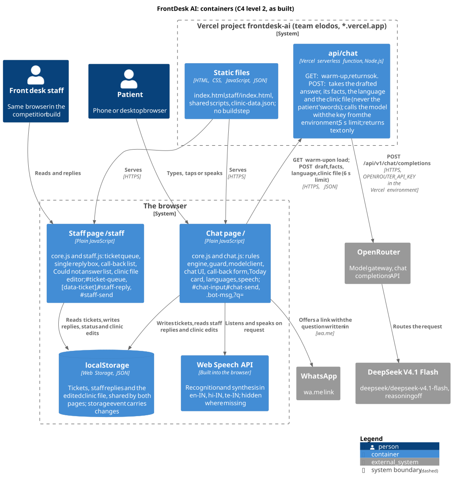
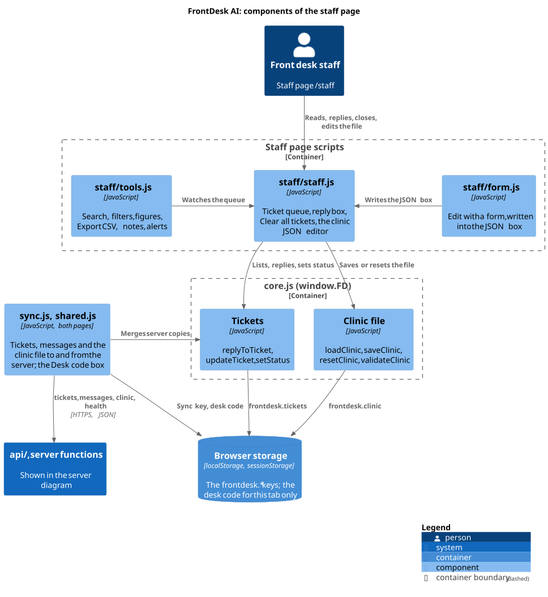
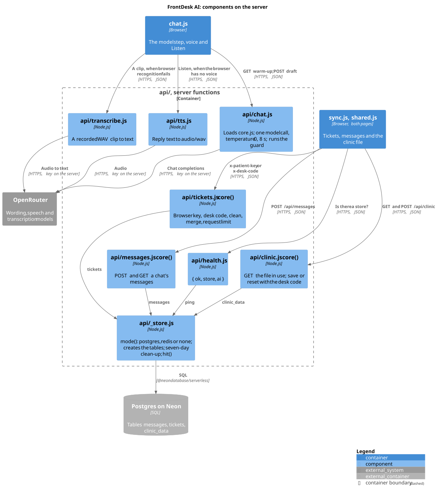

# FrontDesk AI: architecture

This page describes version 1.7.2, the version on the live link.

FrontDesk AI is a front desk for a clinic: a patient chat at `/` and a staff page at `/staff`. It is a static
site with seven small server functions and no build step. A rules engine in the browser answers each question
from the clinic's own file, opens a ticket for it and hands anything it must not answer to a person. A
language model may reword a file answer, and a guard checks its wording against the file. Messages, tickets
and the edited clinic file are kept in Postgres on the server, so staff on any device see every patient's
questions; each browser also keeps its own copy
([where data is kept](docs/data-model.md#where-data-is-kept)).

## Context

A patient asks; staff answer what the assistant passes on. The system reaches four outside services: the
Postgres store, OpenRouter for wording and voice, the browser's own speech services, and Google Fonts.
WhatsApp, Google Maps and the phone are plain links the patient may tap.

## Containers

The browser holds the two pages and their scripts. The host serves the static files and runs the server
functions. Four of the functions reach the store through one module, `api/_store.js`; three reach OpenRouter.

## Components

`core.js` is shared by both pages and is also loaded by `api/chat.js`, so the server and the browser run the
same guard. Every later feature is its own file that hooks the base from outside: `staff/tools.js` only
watches the ticket queue, `staff/form.js` writes only to the JSON box, `compact.js` drives the existing
controls, and `sync.js` and `shared.js` leave at once on a page that has neither the message box nor the
ticket queue.

## Components of the staff page

The staff page loads `core.js`, the three `staff/` scripts, `sync.js` and `shared.js`. The picture above shows
the patient chat; this one shows the same shared parts as the staff page uses them.

### Components on the server

The routes in `api/` are drawn on their own. Four of them reach the store through `api/_store.js`, and three
reach OpenRouter.

## The files

| File | Job |
| --- | --- |
| `index.html` | The patient chat page |
| `core.js` | The clinic file, the rules engine, the guard, tickets, languages and theme; exposes `window.FD` |
| `chat.js` | The chat: sending, the model step, voice, Listen, the call-back form, the Clinic info panel, `?q=` |
| `layout.js` | Pins the clinic panel beside the chat from 1024 px |
| `compact.js` | The "+" menu, and on a phone the strip with language, theme and emergency |
| `callback-ask.js` | One line above the call-back form while no phone number is known |
| `mark-link.js` | The brand mark in the top bar opens `https://sai4b.com` in a new tab |
| `sync.js` | Mirrors tickets to `/api/tickets`; the "Desk code" box and "Show tickets from all devices"; exposes `window.FDSync` |
| `shared.js` | The clinic file from `/api/clinic`, messages to `/api/messages`; exposes `window.FDShared` |
| `styles.css`, `brand.css`, `layout.css`, `compact.css` | Base styles; brand palette and fonts; the wide layout; the phone chat and the desktop composer |
| `clinic-data.json` | The shipped clinic file |
| `icon.svg`, `brand-mark.svg` | The page icon and the brand mark |
| `staff/index.html` | The staff page |
| `staff/staff.js` | The ticket queue, the reply box, "Clear all tickets" with Undo, the clinic JSON editor |
| `staff/tools.js` | Search, filters, sort, figures, "Export CSV", ready-made replies, the private note, urgent alerts |
| `staff/form.js` | "Edit with a form", generated from the JSON box |
| `staff/tools.css`, `staff/form.css` | Styles for the two staff add-ons |
| `api/_store.js` | Not a route. Chooses the store, creates the tables, reads and writes tickets, messages and the clinic file, counts requests |
| `api/health.js` | Says whether the store answers and whether a model key is set |
| `api/chat.js` | The wording step: one model call, then the guard |
| `api/tickets.js` | Reads and merges tickets |
| `api/messages.js` | Stores and lists a chat's messages |
| `api/clinic.js` | Returns the clinic file in use; saves or resets it |
| `api/transcribe.js` | Backup voice input: a recorded clip to text |
| `api/tts.js` | Backup voice for Listen: a reply to audio |
| `package.json`, `VERSION`, `.vercelignore` | One dependency (`@neondatabase/serverless`), Node 20 or later; the version number; what stays off the site |

The chat page loads `core.js`, `chat.js`, `layout.js`, `sync.js`, `shared.js`, `compact.js`,
`callback-ask.js`, `mark-link.js`. The staff page loads `core.js`, `staff/staff.js`, `staff/tools.js`,
`staff/form.js`, `sync.js`, `shared.js`, `mark-link.js`.

## The routes

Every JSON reply carries `Cache-Control: no-store`. Limits are per caller address per minute.

| Route | Methods | Who may call | Limit |
| --- | --- | --- | --- |
| `/api/health` | GET | Anyone | None |
| `/api/chat` | GET (warm-up), POST | Anyone | 60 POST, or `FRONTDESK_CHAT_PER_MINUTE` |
| `/api/tickets` | GET, POST | A browser with its key (`x-patient-key`) for its own tickets; the desk code (`x-desk-code`) for every device's | 240 GET, 120 POST |
| `/api/messages` | GET, POST | A browser with its key; the desk code may read | 240 GET, 120 POST |
| `/api/clinic` | GET, POST | GET anyone; POST the desk code only | 240 GET, 120 POST |
| `/api/transcribe` | GET, POST | Anyone | None |
| `/api/tts` | GET, POST | Anyone | None |

The request and reply of the wording route are in [the wording route](docs/schema/api-chat.md).

## How an answer is made

1. The message goes to `FD.answer` in the browser. The rules run in a fixed order: emergency, a rule change
   wrapped round a symptom, a rule change or discount, medical, a doctor the file does not hold, booking,
   greeting, an answer from the file, and last "not sure".
2. Only a file answer may go to `/api/chat`. The model rewords the draft; the guard runs on the server and
   again in the browser. With no key, a slow model or a rejected reply, the patient sees the engine's own
   text.
3. A ticket is made for the question and saved in this browser. `sync.js` sends it to `/api/tickets`, and
   `shared.js` sends the question and the reply to `/api/messages`.
4. Before an answer, `shared.js` fetches the clinic file from `/api/clinic`, waiting 2 seconds at most. An
   emergency never waits.

The step-by-step flows, each with its diagram, are in [the journeys](docs/journeys.md).

## Hosting

The site is hosted on Vercel: static files plus the functions in `api/`. There is no routing file; each file
in `api/` is a route, and a leading underscore keeps `_store.js` from being one. The store is Postgres on
Neon. How to run and release it is in [the implementation plan](IMPLEMENTATION-PLAN.md#release-it); why each
technology was chosen is in [the tech stack](TECH-STACK.md#choices).

| Environment variable | Use |
| --- | --- |
| `DATABASE_URL` | The Postgres store. When set, it is the store. |
| `FRONTDESK_DESK_CODE` | The clinic's desk code. Empty means nobody can read every device's tickets or save the clinic file for all. |
| `OPENROUTER_API_KEY` | The model key. Without it the three model routes answer 503 and the chat uses the engine's own text. |
| `OPENROUTER_MODEL`, `OPENROUTER_AUDIO_MODEL`, `OPENROUTER_TTS_MODEL` | Optional model ids for wording, transcription and speech |
| `FRONTDESK_CHAT_PER_MINUTE` | Optional request limit for `/api/chat` |
| `KV_REST_API_URL`, `KV_REST_API_TOKEN`, `UPSTASH_REDIS_REST_URL`, `UPSTASH_REDIS_REST_TOKEN` | The Redis fallback store, used only when `DATABASE_URL` is not set; when set, they also hold the request counts |

When the store cannot be reached, `/api/clinic` still returns the shipped file, `sync.js` and `shared.js` go
quiet and try again later, and both pages work from the browser's own copy. The staff page says so under the
ticket list and under the clinic file editor.

## Security and privacy

- Keys stay on the server. The model key, the store address and the desk code are environment variables; none
  is in the code or in a reply.
- A browser proves itself with a private key it makes once. The server stores only the SHA-256 hash of that
  key as the owner of a ticket or chat. The desk code is compared in constant time over hashes.
- A patient's browser can read and change only its own tickets and chat. Staff need the desk code to see
  every device's tickets, and to save or reset the clinic file for all. Staff cannot create tickets.
- The model receives the draft answer, its facts and the clinic file, not the patient's message. OpenRouter
  (`openrouter.ai`) is called from the server only, with `https://frontdesk-ai.vercel.app` as the referer
  header.
- Other outside addresses: `fonts.googleapis.com` and `fonts.gstatic.com` on page load; `wa.me`,
  `web.whatsapp.com` and `www.google.com/maps/search/` only when the patient taps the link; `sai4b.com` as a
  plain link.
- SQL is written as tagged templates only, so values are always parameters.
- `/api/transcribe` and `/api/tts` have no request limit and need no key from the caller.

What a patient is told about their data is in [the README](README.md#privacy).

## Accessibility

Both pages have a light and a dark theme, follow `prefers-color-scheme` and `prefers-reduced-motion`, and
have a skip link ("Skip to the message box"). The chat is laid out for a phone up to 767 px, a desktop from
768 px, and with the clinic panel pinned from 1024 px.

## Languages

English, Hindi and Telugu. A message in Devanagari or Telugu script is answered in that language; a message in
English letters is answered in the language chosen on the page. Every fixed reply exists in all three. Voice
input and Listen use the browser's own speech first, then `/api/transcribe` and `/api/tts`.

## Known risks

See [known limits](REPORT.md#known-limits).
