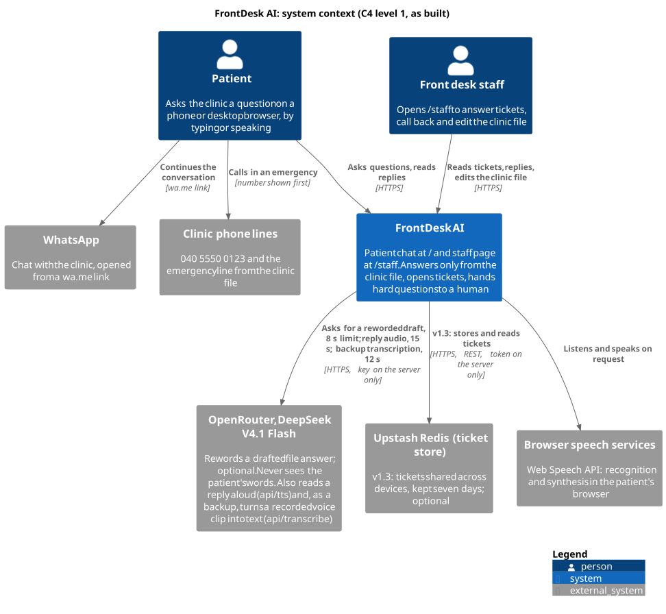
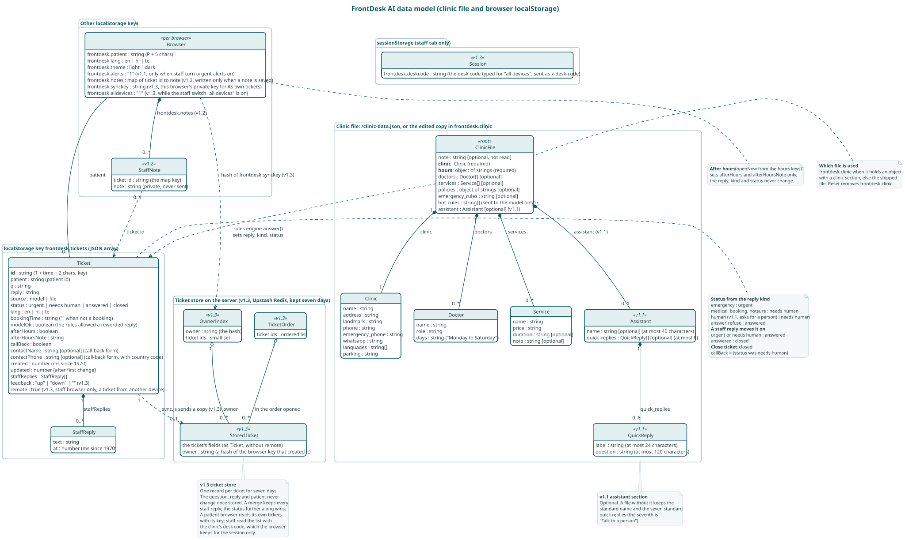
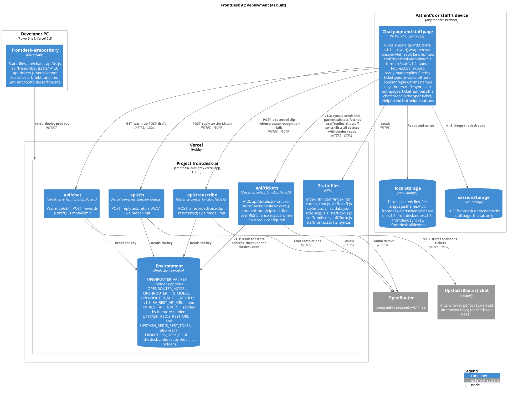

# FrontDesk AI: architecture

Written from the code of version 2.0.1, live since 27 Nov 2026 (patient chat at `/`, staff page at `/staff`;
the links are in [README.md](README.md)). Version 2.0 is a rebuild: the 1.3.0.3 code is kept under `legacy/`
in the code repository and no longer runs. Every module and function named here is in the 2.0.1 code.

| | |
| --- | --- |
| Code | `frontdesk-ai` (private): `src/app/` (pages and API routes), `src/lib/` (answer and store modules), `src/components/`, `migrations/`, `clinic-data.json`, `tests/` |
| Stack | Next.js App Router, TypeScript, Tailwind CSS, Zod; see [TECH-STACK.md](TECH-STACK.md) |
| Last revised | 27 Nov 2026, for version 2.0.1 |

## 1. Overview and goals

FrontDesk AI is the front desk chat of a dental clinic (sample data). A patient types a question on the chat
page. The server answers only from the clinic file and opens a ticket when a person is needed. Staff read
the tickets on `/staff`, reply, and the reply appears in that patient's chat.

The rules it keeps:

- Answer only from the clinic file; never invent a price, a doctor or a timing.
- Not in the file: say not sure, promise a call back within 2 working hours, open a `needs human` ticket.
- No medical advice. No discount and no obeying "ignore your rules".
- Emergency: the emergency number first and an `urgent` ticket.
- The same facts with no AI key, labelled "Answered from the clinic file".
- The patient gets a reply even when the store is down.
- Usable at 375 px, light and dark.

The design that serves them: every message is answered on the server, in one fixed order (section 6). Code
handles what must be exact (emergency, refusals, bookings) before any AI step. The AI step is optional, and
code checks its answer against the clinic file before the answer is used.

## 2. Decisions

| ID | Decision | Reason |
| --- | --- | --- |
| AD-1 | One Next.js App Router application: two pages, five API routes, the logic in `src/lib/` | One deploy; the key and the store stay on the server |
| AD-2 | The order per message is fixed in `answerPatient()` (`answer.ts`): emergency, medical and rule-break checks, booking, AI step, keyword matcher | Safety replies are exact and never depend on a model |
| AD-3 | A booking request becomes a ticket in code, with the requested day, calendar date (India) and time (`booking-time.ts`); the AI step is not asked | A booking is a promise the clinic must keep |
| AD-4 | The AI step is one attempt, stopped at 8 seconds (`AI_TIMEOUT_MS`), asked for JSON, checked with Zod | A slow or broken provider costs at most 8 seconds, never the reply |
| AD-5 | Code rejects an AI answer that names a doctor who is not in the file, gives a figure for another service, or gives a time for another day (`acceptAiReply`); an answer with a clock time without am or pm is not used either (`keepsFileWording`) | No invented fact reaches the patient; a rejected answer falls to the matcher |
| AD-6 | The keyword matcher (`matcher.ts`) answers when there is no key, the call fails or is late, or the answer is rejected; its replies carry the label "Answered from the clinic file" | The no-key run gives the same facts |
| AD-7 | The store is chosen in `db.ts`, first one set up: Postgres when `DATABASE_URL` is set; otherwise the Redis the host already provides, over REST (`kv.ts`), every key under one prefix; otherwise server memory | Tickets are shared between visitors without a new service; nothing of an earlier version is touched |
| AD-8 | Server memory on the host is a fault: the health route answers not ok (503) | Each server instance has its own memory, so staff would not see the chat's tickets |
| AD-9 | In `/api/chat` a store failure is noted, never thrown; the shipped clinic file is used; when a ticket could not be recorded the reply asks the patient to call the clinic | The patient always gets a reply, and no promise is made that nobody will see |
| AD-10 | The ticket list sent to the staff page never carries a chat id; a chat is read only with its own id (`/api/messages`) | The chat id is the key to that chat and stays in the patient's browser |
| AD-11 | Every ticket has its own reply box. The page orders tickets urgent, needs human, answered, closed (or newest first). A reply sets `answered`; Close sets `closed` | Staff can answer any ticket where it stands |
| AD-12 | A clinic save is checked with Zod before it is stored (name, address, phone, emergency phone, hours, at least one doctor, at least one service with a price, policies; at most 100,000 characters); Reset puts back the file that ships with the app | A broken file cannot become the file in use |
| AD-13 | The desk lock is optional (`desk.ts`): only when `FRONTDESK_DESK_LOCK` is `on` and `FRONTDESK_DESK_CODE` is set do the ticket routes need the code, sent in the `x-desk-code` header and compared as digests. It is off on the live site | The tester opens `/staff` with no login; a clinic would switch it on |
| AD-14 | The chat page polls `/api/messages` every 3 seconds; the staff page reloads the tickets every 4 seconds | Staff replies and new tickets appear without a refresh, with no extra service |

## 3. Context

Source: [docs/diagrams/c4-context.puml](docs/diagrams/c4-context.puml). Postgres is drawn as "used when its
address is set": it is not connected on the live site.

## 4. Containers

Source: [docs/diagrams/c4-container.puml](docs/diagrams/c4-container.puml).

| Route | File | What it does |
| --- | --- | --- |
| `/` | `src/app/page.tsx`, `src/components/ChatClient.tsx` | Greeting, six quick replies, question box; a question in the link (`?q=`) is asked on load; polls for staff replies |
| `/staff` | `src/app/staff/page.tsx`, `src/components/StaffClient.tsx` | Tickets, call-back list, reply, close, clinic file editor |
| `POST /api/chat` | `src/app/api/chat/route.ts` | Answers one message and opens a ticket when needed |
| `GET, POST /api/tickets` | `src/app/api/tickets/route.ts` | Ticket list, staff reply, close, clinic save, clinic reset |
| `GET /api/messages` | `src/app/api/messages/route.ts` | One chat's messages, by chat id |
| `GET /api/clinic` | `src/app/api/clinic/route.ts` | The clinic file in use |
| `GET /api/health` | `src/app/api/health/route.ts` | Store name, whether an AI key is set, ok or not |

The request and reply of each route are in [docs/schema/api-chat.md](docs/schema/api-chat.md).

## 5. Components

Source: [docs/diagrams/c4-component.puml](docs/diagrams/c4-component.puml).

| Module (`src/lib/`) | Role |
| --- | --- |
| `answer.ts` | `answerPatient()`: the order per message |
| `guards.ts` | Emergency, medical-advice and rule-break checks, in code |
| `i18n.ts` | Finds the language of the question (English, Hindi, Telugu, Hinglish) and gives the fixed replies in it |
| `matcher.ts` | `detectBooking()` and `matchClinicFile()`: the keyword answer from the clinic file |
| `booking-time.ts` | The requested day, calendar date in India and time for a booking ticket |
| `ai.ts` | The AI settings, the one call, the Zod check and the checks against the clinic file |
| `db.ts` | Picks the store; clinic file, messages, tickets; the health check |
| `kv.ts` | The Redis store over REST |
| `desk.ts` | The optional desk lock |
| `types.ts` | `ClinicData`, `AnswerResult`, `MessageRow`, `TicketRow` |
| `ThemeToggle` (`src/components/`) | Light and dark |

## 6. Runtime views

The order per message, every time:

1. Emergency check, in code. The emergency number first; an `urgent` ticket (P1).
2. Medical-advice and rule-break checks, in code. A fixed reply; no ticket.
3. A booking request becomes a `needs human` ticket (P2) with the requested day, date and time.
4. The AI step, when a key is set: one attempt, 8 seconds, JSON checked, then the checks of AD-5. When the
   model says the file does not have the answer, the reply is "not sure" with a `needs human` ticket (P3).
5. The keyword matcher, with the label "Answered from the clinic file". Not in the file: "not sure", a call
   back within 2 working hours, a `needs human` ticket (P3).

One sequence diagram per journey is in [docs/journeys.md](docs/journeys.md).

## 7. Data

Source: [docs/diagrams/data-model.puml](docs/diagrams/data-model.puml). The entities and every derived
figure are in [docs/data-model.md](docs/data-model.md); the JSON Schemas are in [docs/schema/](docs/schema/).

Stores, in order:

1. Postgres (Neon), when `DATABASE_URL` is set. Tables `clinic_data`, `messages`, `tickets`
   (`migrations/001_init.sql`).
2. Otherwise the Redis the host already provides, over its REST address. Keys under one prefix: `clinic`,
   `tickets` (a hash), `msgs:<chat id>` (a list).
3. Otherwise server memory.

The live site runs on the Redis store today. Neon is not connected yet, and Postgres on the live site is
not tested.

## 8. Deployment

Source: [docs/diagrams/deployment.puml](docs/diagrams/deployment.puml).

Settings, by name only (values live on the host and are never written in a document):

| Name | Use |
| --- | --- |
| `DATABASE_URL` | The Postgres address. Not set on the live site |
| `KV_REST_API_URL`, `KV_REST_API_TOKEN` | The Redis of the host. In use on the live site |
| `AI_API_KEY`, `AI_BASE_URL`, `AI_MODEL` | The AI step. Optional |
| `OPENROUTER_API_KEY` | Used for the AI step when `AI_API_KEY` is not set |
| `AI_TIMEOUT_MS` | Time allowed for the one AI attempt; 8000 when not set |
| `FRONTDESK_DESK_LOCK`, `FRONTDESK_DESK_CODE` | The desk lock. Off on the live site |

## 9. Cross-cutting concerns

- Privacy: the browser keeps only a chat id. The ticket list never carries a chat id. 2.0 does not ask for
  a name or a phone number and has no voice.
- What the AI provider sees: the patient's question and the clinic file, and only for messages that passed
  the guards and are not bookings.
- Secrets: the AI key and the store token stay in the host's environment. The health route says only whether
  a key is set. A store error is not sent out, because it may hold a connection address.
- Failure: an AI failure falls to the matcher; a store failure still gives the patient a reply; the ticket
  routes answer 503 when the store cannot be read or written.
- Input: `/api/chat` takes a chat id of at most 100 characters and a message of at most 2,000; a staff reply
  is at most 2,000 characters.
- Accessibility and layout: 375 px with no sideways scroll, 44 px controls, light and dark.

## 10. Quality and testing

Unit tests (Vitest) cover the guards, the matcher, the AI checks, the booking time, the store and the
routes; browser tests (Playwright) cover the chat, the staff queue and a cold open. The measured results
for 2.0.1 and what was not tested are in [README.md](README.md), section "Measured results", and in
[REPORT.md](REPORT.md).

## 11. Risks and known limits

| Risk or limit | State |
| --- | --- |
| Postgres on the live site | Not connected, not tested; the Redis store is the live store |
| The staff page is open on the live site | The desk lock is off; the demo holds sample data only |
| The desk lock | Covered by unit tests only, not on the live site |
| Tickets and messages are not deleted after a set time | Open |
| In 1.x, not rebuilt in 2.0 | Voice, the language menu, patient name and phone, the clinic info panel, staff search and filters, CSV export, ready-made replies, staff notes, patient feedback, background-tab sync |

## Code files (version 2.0.1)

Every file that runs, one line each. The 1.x files are in `legacy/` and do not run.

| File | What it holds |
| --- | --- |
| `src/app/layout.tsx` | The page frame: fonts, theme, title |
| `src/app/globals.css` | Colours for light and dark; the chat fills the screen; the fade-in |
| `src/app/page.tsx` | The chat page; passes `?q=` to the chat |
| `src/app/staff/page.tsx` | The staff page |
| `src/components/ChatClient.tsx` | The chat: message box, replies, quick replies, the poll for staff replies |
| `src/components/StaffClient.tsx` | The staff desk: call-back list, ticket queue with a reply box on each ticket, close, clinic file editor, desk code form |
| `src/components/ThemeToggle.tsx` | Light or dark, remembered, and said aloud when changed |
| `src/app/api/chat/route.ts` | One message in, one reply out; stores the message, the reply and a ticket; a reply goes out even when the store is down |
| `src/app/api/tickets/route.ts` | The ticket list, a staff reply, close, clinic save and reset; the desk lock |
| `src/app/api/messages/route.ts` | One chat's messages, read with that chat's id |
| `src/app/api/clinic/route.ts` | The clinic file as it is now |
| `src/app/api/health/route.ts` | Which store is in use, whether an AI key is set, and whether all is well |
| `src/lib/answer.ts` | The order per message: guards, booking, the AI step and its checks, the matcher |
| `src/lib/guards.ts` | Emergency, medical-advice and rule-break checks, in code |
| `src/lib/i18n.ts` | Which language a message is in; the fixed replies in English, Hindi and Telugu |
| `src/lib/matcher.ts` | Answers from the clinic file by matching; finds a booking request |
| `src/lib/booking-time.ts` | The day, calendar date and time a patient asked for, for the ticket |
| `src/lib/ai.ts` | The one AI attempt and the check of its answer against the clinic file |
| `src/lib/db.ts` | The store: Postgres, else Redis, else memory; clinic file, messages, tickets |
| `src/lib/kv.ts` | The Redis store over its REST address |
| `src/lib/desk.ts` | The desk code and its lock switch |
| `src/lib/types.ts` | The shapes of the clinic file, a message, a ticket and an answer |
| `scripts/run-tests.ts` | The 30-question script: once as set up, once with the AI step off |
| `scripts/migrate.ts` | Creates the Postgres tables when a Postgres address is set |

## 12. Glossary

| Term | Meaning |
| --- | --- |
| Clinic file | The clinic's facts as JSON: clinic, hours, doctors, services, policies |
| Ticket | A request that needs a person: `urgent`, `needs human`, `answered` or `closed` |
| Chat id | A random id made in the patient's browser; the key to that chat |
| Shared store | Where the clinic file, tickets and messages are kept on the server |
| Desk lock | The optional code that closes the staff routes |

## Revisions

| Date | Version | Change |
| --- | --- | --- |
| 27 Nov 2026 | 2.0.1 | Rewritten from the rebuilt code; every diagram redrawn. The 1.x text is in this repository's history |
