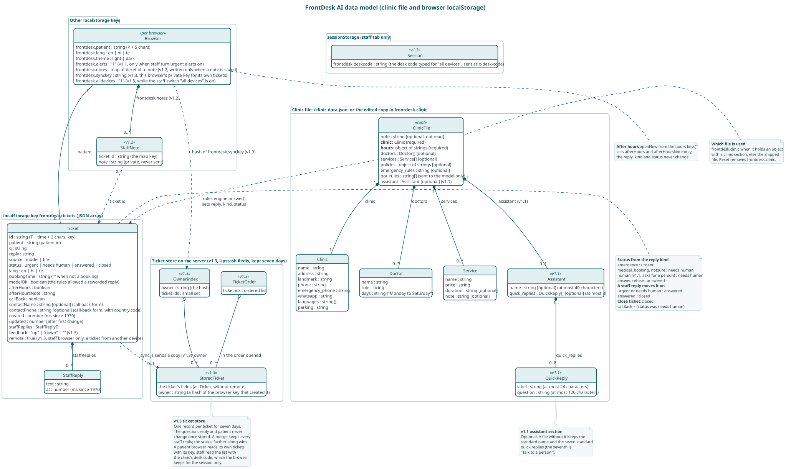
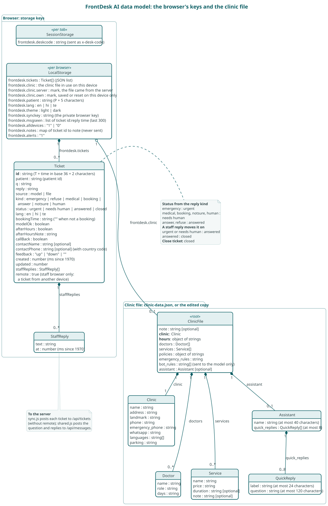

# FrontDesk AI: the data model

This page describes version 1.7.2, the version on the live link.

The server keeps the shared copy of everything that must reach more than one device: chat messages, tickets
and the edited clinic file, in three Postgres tables on Neon. Each browser also keeps its own copy of its
tickets and of the clinic file, so a page draws at once and still works when the server cannot be reached.

## Where data is kept

| What | Where exactly | Who can read it | How long it stays |
| --- | --- | --- | --- |
| Chat messages (each patient message, bot reply and staff reply) | Server: table `messages` | The browser that started the chat, with its private key; staff with the desk code | 7 days |
| Tickets, shared copy | Server: table `tickets` | A patient's browser reads its own tickets, with its key and patient id; staff read every device's tickets with the desk code | 7 days |
| The edited clinic file, shared copy | Server: table `clinic_data`, one row | Anyone can read it; only the desk code can save or reset it | Until staff press "Use the original file" |
| The shipped clinic file | The static file `clinic-data.json` | Anyone | Always |
| Tickets, this browser's copy | Browser: `localStorage` key `frontdesk.tickets` | That browser only | Until "Clear all tickets" or the site's data is cleared |
| The clinic file, this device's copy | Browser: `localStorage` key `frontdesk.clinic` | That browser only | Until replaced by the server's copy or reset |
| The browser's private key | Browser: `localStorage` key `frontdesk.synckey`; the server stores only its SHA-256 hash, as `owner` | That browser only | Until the site's data is cleared |
| The desk code as typed | Browser: `sessionStorage` key `frontdesk.deskcode`; the real code is the server's `FRONTDESK_DESK_CODE` | That tab only | Until the tab closes |
| Private staff notes | Browser: `localStorage` key `frontdesk.notes`; never sent | That browser only | Until removed |
| Request counts | Server memory of one instance (or Redis when its variables are set) | Nobody | One minute |

The browser keeps its own copy for three reasons: the chat shows a reply without waiting for the server, the
staff page shows something without a desk code (this browser's own tickets), and both pages keep working when
the store is slow or down.

## Which store the server uses

`api/_store.js` chooses on every request:

| Order | Condition | Store |
| --- | --- | --- |
| 1 | `DATABASE_URL` is set | Postgres, through `@neondatabase/serverless`. This is the live site: `/api/health` answers `"store":"postgres"`. |
| 2 | No `DATABASE_URL`, and `KV_REST_API_URL` or `UPSTASH_REDIS_REST_URL` with `KV_REST_API_TOKEN` or `UPSTASH_REDIS_REST_TOKEN` | Redis over REST. A fallback kept in the code; the live site does not use it. |
| 3 | Neither | None. The ticket and message routes answer 503, `/api/clinic` returns the shipped file, and each page works from its browser's copy. |

In Redis mode the keys are `fd:t:<id>` (a ticket, 7 days), `fd:idx` (the order, cut to 300), `fd:o:<owner hash>`
(a browser's tickets), `fdb:clinic` (the clinic file), `fdb:m:<chat>` (a chat's messages, cut to 400, 7 days)
and `fdb:mo:<chat>` (the chat's owner). The request counter uses `fd:rl:<key>:<minute>`.

## The server tables

Created with `CREATE TABLE IF NOT EXISTS` on first use. Every query has a 6 second limit.

### messages

| Column | Type | Holds |
| --- | --- | --- |
| `id` | `BIGSERIAL PRIMARY KEY` | The order within a chat |
| `chat_id` | `TEXT` | The chat's id, 3 to 40 letters, digits, `_` or `-` |
| `role` | `TEXT` | `patient`, `bot` or `staff` |
| `text` | `TEXT` | The message, at most 6,000 characters |
| `source` | `TEXT DEFAULT ''` | Where the reply came from |
| `owner` | `TEXT DEFAULT ''` | Hash of the key of the browser that sent it; the first row's owner owns the chat |
| `created_at` | `BIGINT` | Milliseconds since 1970 |

Index `messages_chat (chat_id, id)`. A read returns up to 400 messages, oldest first. Rows older than 7 days
are deleted after every insert.

### tickets

| Column | Type | Holds |
| --- | --- | --- |
| `id` | `TEXT PRIMARY KEY` | The ticket id |
| `patient` | `TEXT` | The patient id |
| `owner` | `TEXT` | Hash of the key of the browser that created it |
| `status` | `TEXT` | The ticket's status |
| `priority` | `TEXT DEFAULT 'normal'` | `urgent` when the status is urgent, else `normal` |
| `text` | `TEXT` | The question |
| `reply` | `TEXT` | The bot's reply |
| `data` | `JSONB` | The whole ticket |
| `created_at`, `updated_at` | `BIGINT` | Milliseconds since 1970 |

Index `tickets_owner (owner)`. The staff list returns the newest 300; a patient's own list the newest 60. Rows
older than 7 days are deleted after every write.

### clinic_data

| Column | Type | Holds |
| --- | --- | --- |
| `id` | `INTEGER PRIMARY KEY CHECK (id = 1)` | Always 1: there is one row |
| `data` | `JSONB` | The edited clinic file, under 100,000 characters |
| `updated_at` | `BIGINT` | Milliseconds since 1970 |

A reset deletes the row, and the shipped file is used again.

## The browser's keys

| Key | Storage | Written by | Holds |
| --- | --- | --- | --- |
| `frontdesk.tickets` | localStorage | `core.js`, `sync.js`, `staff/staff.js` | This browser's tickets, a JSON list |
| `frontdesk.clinic` | localStorage | `core.js` | The clinic file in use on this device: an edit, or the server's copy |
| `frontdesk.clinic.server` | localStorage | `shared.js` | A mark: the file in this browser came from the server |
| `frontdesk.clinic.own` | localStorage | `shared.js` | A mark: staff saved or reset on this device only, so the server's copy does not replace it |
| `frontdesk.patient` | localStorage | `core.js` | The patient id, `P` and five characters; removed by New chat |
| `frontdesk.lang` | localStorage | `core.js` | `en`, `hi` or `te` |
| `frontdesk.theme` | localStorage | `core.js`, an inline script in both pages | `light` or `dark` |
| `frontdesk.synckey` | localStorage | `sync.js` | The private key: 48 hex characters, made once, sent as the header `x-patient-key`, never shown |
| `frontdesk.msgseen` | localStorage | `shared.js` | The staff replies already sent on as messages (`<ticket id>:<reply time>`), the last 300 |
| `frontdesk.alldevices` | localStorage | `sync.js` | The staff switch "Show tickets from all devices": `1` or `0` |
| `frontdesk.notes` | localStorage | `staff/tools.js` | Private staff notes per ticket |
| `frontdesk.alerts` | localStorage | `staff/tools.js` | Urgent alerts on: `1` |
| `frontdesk.deskcode` | sessionStorage | `sync.js` (read by `shared.js`) | The desk code, sent as the header `x-desk-code` |

The search, filters and sort on the staff page are kept in memory only. There is no offline cache. The name
`frontdesk-urgent` in `staff/tools.js` is the tag of the browser notification for an urgent ticket, so that a
new one replaces the last; it is not a stored item.

## The ticket

One ticket is made per question. Its fields and limits are in
[the ticket schema](schema/tickets.schema.json). The status comes from the kind of reply:

| Kind of reply | First status |
| --- | --- |
| `emergency` | urgent |
| `medical`, `booking`, `notsure`, `human` | needs human |
| `answer`, `refuse` | answered |

A staff reply moves urgent and needs human to answered, and answered to closed. "Close ticket" sets closed.
The staff page lists urgent first, then needs human, answered and closed, newest first within each.

When a browser's copy and the server's copy of one ticket meet, they are merged: every staff reply of both is
kept, the status further along wins, and a contact or feedback that either side has is kept. The patient, the
question, the bot's reply, the time it was made and the owner never change once stored. A new ticket belongs
to the key that sent it; staff cannot create tickets.

## The clinic file

Every answer comes from this file. Its full shape is in
[the clinic file schema](schema/clinic-file.schema.json).

| Section | Fields |
| --- | --- |
| `note` | Says the clinic in the shipped file is fictional |
| `clinic` | `name`, `address`, `landmark`, `phone`, `emergency_phone`, `whatsapp`, `languages`, `parking` |
| `hours` | `monday_to_saturday`, `sunday`, `lunch_break`, `public_holidays` |
| `doctors` | `name`, `role`, `days` |
| `services` | `name`, `price`, and `note` or `duration` |
| `policies` | `appointments`, `walk_ins`, `payment`, `emi`, `insurance`, `children`, `first_visit`, `sterilisation` |
| `emergency_rules` | One sentence |
| `bot_rules` | The rules sent to the wording model |
| `assistant` (optional) | `name`, and quick replies with `label` and `question` |

The server checks a file before saving it: a JSON object under 100,000 characters; `clinic` with a name,
address, phone and emergency phone; `hours` with at least one line; at least one doctor, each with a name; at
least one service, each with a name and a price. A refusal names the part and changes nothing.
