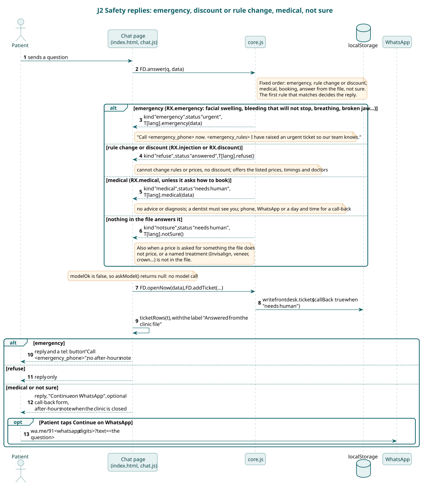
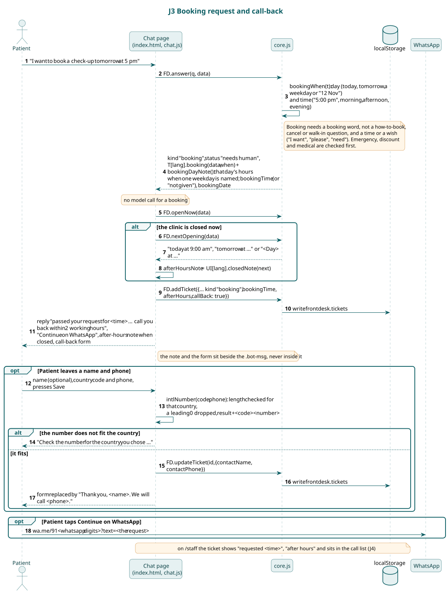
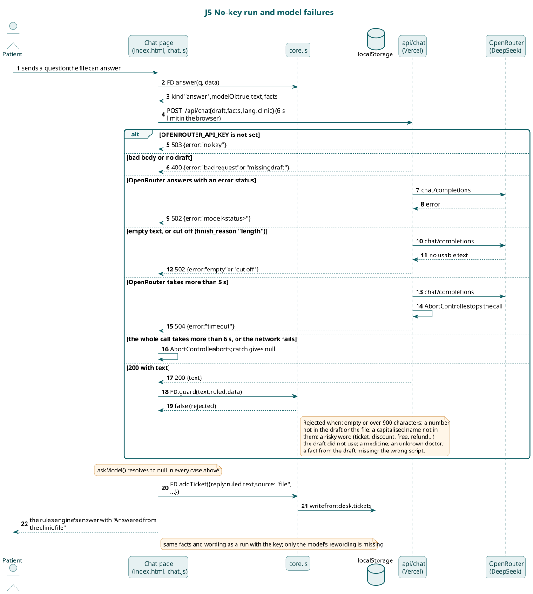
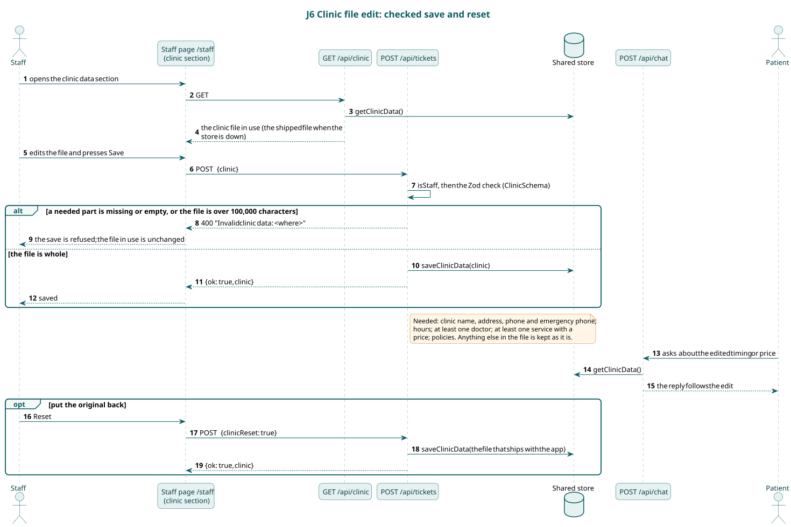
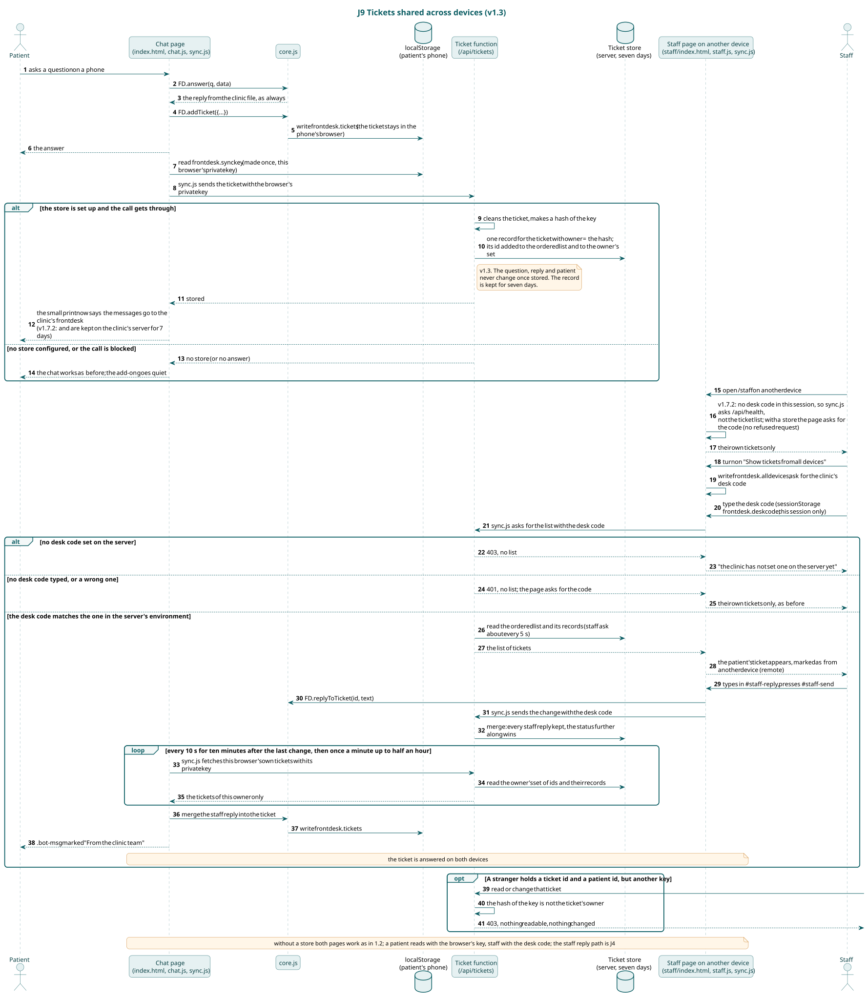

# FrontDesk AI: user journeys

One sequence diagram per journey, drawn from the code of version 2.0.1 (live since 27 Nov 2026). Each
diagram is PlantUML source plus SVG in [diagrams/](diagrams/). The modules named are in `src/lib/`, the
routes in `src/app/api/`, the pages in `src/components/` of the code repository.

## The journeys

| Journey | Who | Routes and modules |
| --- | --- | --- |
| [J1 First visit and ask](#j1-first-visit-and-ask) | Patient | `/`, `POST /api/chat`, `answer.ts`, `ai.ts`, `matcher.ts` |
| [J2 Safety replies](#j2-safety-replies) | Patient | `POST /api/chat`, `guards.ts`, `i18n.ts` |
| [J3 Booking and call-back](#j3-booking-and-call-back) | Patient, staff | `POST /api/chat`, `matcher.ts`, `booking-time.ts`, `/staff` |
| [J4 Staff reply](#j4-staff-reply) | Staff, patient | `/staff`, `/api/tickets`, `desk.ts`, `GET /api/messages` |
| [J5 No-key run](#j5-no-key-run) | Patient | `answer.ts`, `ai.ts`, `matcher.ts` |
| [J6 Clinic file edit](#j6-clinic-file-edit) | Staff | `/staff`, `GET /api/clinic`, `POST /api/tickets` |
| [J9 Shared tickets](#j9-shared-tickets) | Patient, staff | `db.ts`, `kv.ts`, `GET /api/health` |

J7 (languages and voice) and J8 (ask for a person) were journeys of version 1.x. 2.0.1 has no voice, no
language menu and no ask-for-a-person rule, so they are removed. Replies in Hindi and Telugu, when the
question is written in that language, are part of J1 and J2. The numbers J7 and J8 are not reused.

## J1 First visit and ask

Source: [diagrams/j1-first-visit-and-ask.puml](diagrams/j1-first-visit-and-ask.puml).

- The chat page makes a chat id and keeps it in the browser's local storage. Nothing else is kept there.
- It shows a greeting, six quick replies and the question box. A question in the link (`?q=`) is asked on load.
- `POST /api/chat` reads the clinic file, stores the message and calls `answerPatient()`.
- The order per message: emergency check; medical-advice and rule-break checks; booking request; the AI
  step (one attempt, 8 seconds, JSON checked with Zod); the keyword matcher.
- Code rejects an AI answer that names a doctor who is not in the file, gives a figure for another service,
  gives a time for another day, or writes a clock time without am or pm. The matcher then answers.
- A matcher reply carries the label "Answered from the clinic file".
- A store fault is noted, never thrown: the patient still gets a reply.

## J2 Safety replies

Source: [diagrams/j2-safety-replies.puml](diagrams/j2-safety-replies.puml).

- The guards run in code before any AI step; the model is never asked.
- Emergency: the emergency number first, in English, Hindi, Telugu or Hinglish; an `urgent` ticket (P1).
- Medical advice: no medicine is named; a dentist must see the patient. No ticket.
- Discount or "ignore your rules": refused. No ticket.
- If the urgent ticket could not be recorded, the reply also asks the patient to call the clinic.

## J3 Booking and call-back

Source: [diagrams/j3-booking-and-call-back.puml](diagrams/j3-booking-and-call-back.puml).

- A booking request is found in code (`detectBooking`), after the guards. The AI step is not asked.
- The ticket is `needs human` (P2). Its text is the question with the requested day, the calendar date in
  India and the time, for example "requested tomorrow, Fri 27 Nov 2026, 5:00 pm".
- 2.0.1 does not ask the patient for a name or a phone number.
- On `/staff` the ticket is on the "To call back" list. Staff reply on the ticket or close it.

## J4 Staff reply

Source: [diagrams/j4-staff-reply.puml](diagrams/j4-staff-reply.puml).

- `/staff` loads the tickets and reloads them every 4 seconds. The list never carries a chat id.
- Order: urgent, needs human, answered, closed; newest first within a status. Staff can switch to newest first.
- Every ticket has its own reply box. A waiting ticket older than 2 hours is marked.
- A reply is saved on the ticket, sets the status to `answered` and adds a message with role `staff` to
  that patient's chat.
- The patient's chat page polls `GET /api/messages` with its chat id every 3 seconds and shows the reply.
- Close sets the status to `closed`.
- The desk lock is optional and off on the live site. When it is on, the ticket routes answer 401 without
  the code, and the page asks for it and keeps it for the session only.

## J5 No-key run

Source: [diagrams/j5-no-key-run.puml](diagrams/j5-no-key-run.puml).

- With no AI key, the guards and the booking check run as always and the keyword matcher answers.
- The matcher also answers when the AI call fails or is late, when its JSON is wrong, and when code rejects
  the answer.
- Every matcher reply that gives a fact carries the label "Answered from the clinic file".
- Not in the file: "not sure", a call back within 2 working hours and a `needs human` ticket (P3).

## J6 Clinic file edit

Source: [diagrams/j6-clinic-file-edit.puml](diagrams/j6-clinic-file-edit.puml).

- The editor on `/staff` loads the clinic file in use from `GET /api/clinic`.
- Save posts the file to `/api/tickets`. It is checked with Zod before it is stored: clinic name, address,
  phone and emergency phone; hours; at least one doctor; at least one service with a price; policies; at
  most 100,000 characters. A file that fails is refused with the place of the fault.
- The next reply follows the edit, because every answer is worked out from the file in use.
- Reset puts back the clinic file that ships with the app.

## J9 Shared tickets

Source: [diagrams/j9-shared-tickets.puml](diagrams/j9-shared-tickets.puml).

- The store is the first one set up: Postgres (Neon) when `DATABASE_URL` is set; otherwise the Redis the
  host already provides, over REST, keys under one prefix; otherwise server memory.
- The live site runs on the Redis store today. Neon is not connected yet.
- A ticket opened from one device is on the staff page of any other device.
- When the store cannot be reached, the patient still gets a reply; the ticket routes answer 503.
- `GET /api/health` names the store and says whether an AI key is set, never the key. Server memory on the
  host is a fault: not ok, status 503.
