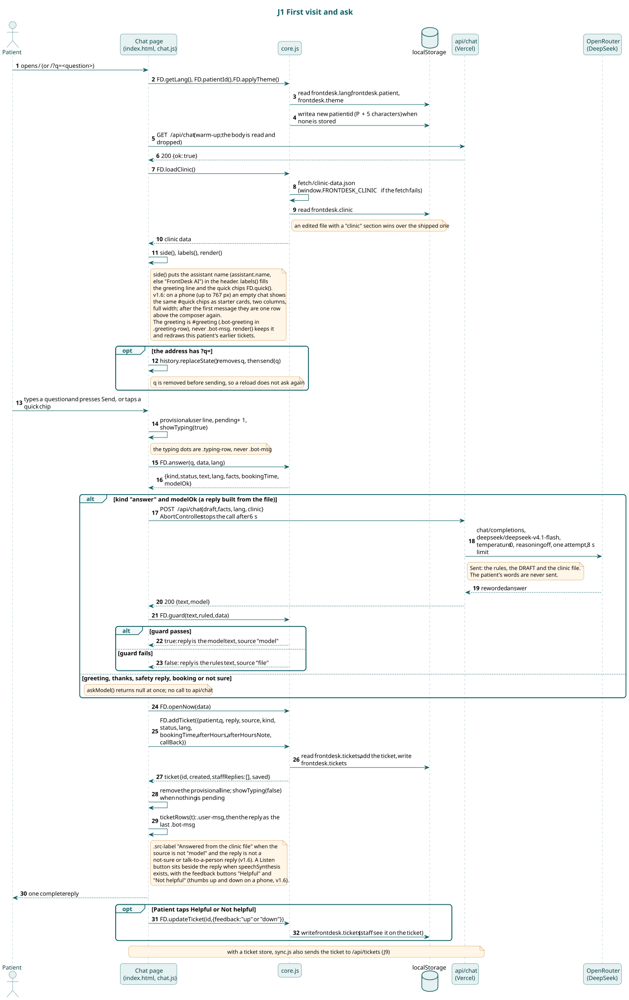
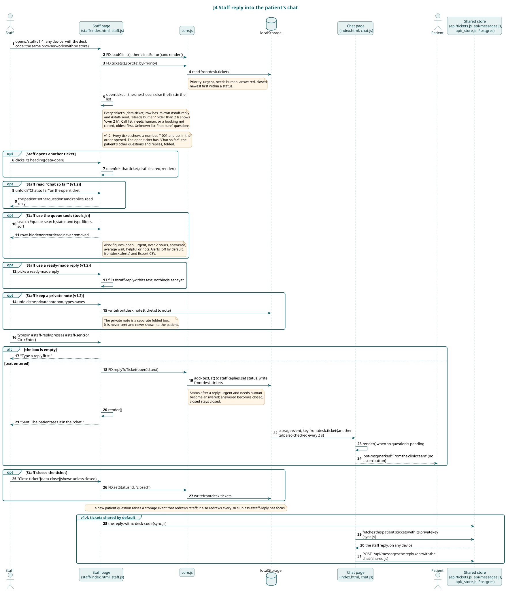
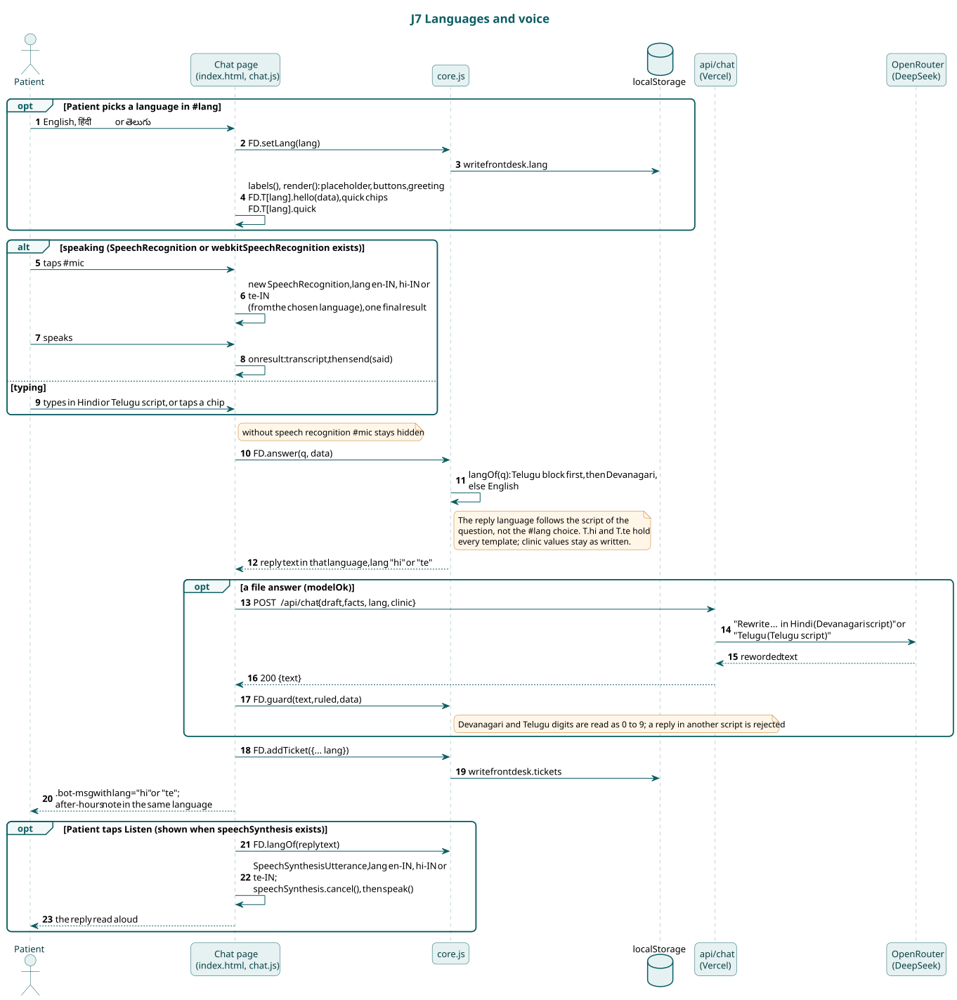

# FrontDesk AI: user journeys

This page walks through what a patient and the clinic's staff do with FrontDesk AI and what the app does
in reply. Each journey is drawn from the code as built: `core.js` (clinic data, the rules engine
`answer()`, the reply guard `guard()`, tickets, statuses and opening hours), `chat.js` with `index.html`
(the patient chat), `staff/staff.js` with `staff/index.html` (the staff page) and `api/chat.js` (the one
server function on Vercel). The function names, the order of calls and what is read from and written to
`localStorage` are as the code has them. Nothing here is planned work.

Live: https://frontdesk-ai-xi-gray.vercel.app (patient chat) and https://frontdesk-ai-xi-gray.vercel.app/staff
(staff page).

Three things hold in every journey:

- **The rules engine decides every answer.** `FD.answer()` works the reply out from the clinic file in a
  fixed order: emergency, rule change or discount, medical, booking, answer from the file, not sure. A
  language model is asked only to reword a reply that came from the file, and only through `api/chat`.
- **The model never sees the patient's words.** `api/chat` sends OpenRouter (model
  `deepseek/deepseek-v4.1-flash`) the rules, the drafted answer and the clinic file. The browser then
  checks the reworded text with `FD.guard()`; anything it rejects, and any failure or delay, falls back to
  the drafted file answer with the label "Answered from the clinic file". Every reply the model did not word carries
  that label, including the fixed emergency, refuse, medical, booking, greeting and not-sure templates.
- **Everything is stored in this browser.** Tickets (`frontdesk.tickets`), an edited clinic file
  (`frontdesk.clinic`), the patient id (`frontdesk.patient`), the language (`frontdesk.lang`) and the theme
  (`frontdesk.theme`) live in `localStorage`. The staff page reaches the patient's chat through the
  browser's `storage` event, so both pages must be open in the same browser.

Every diagram is a PlantUML sequence diagram rendered to SVG. Participants appear in the same order in
each one: the person (Patient or Staff), the page they use, `core.js`, `localStorage`, `api/chat` (Vercel),
OpenRouter (DeepSeek) and WhatsApp. In J4 and J6 the patient's chat page and the patient follow
`localStorage`, because they receive the change. A diagram shows only the participants it uses. The shared
look is in [style.iuml](diagrams/style.iuml).

To render again, from this folder (`frontdesk-ai-docs`):

```
java -jar plantuml.jar -tsvg -charset UTF-8 docs/diagrams/j*.puml
```

Epics (from [epics.md](epics.md)): E1 Patient chat, E2 Answers from the clinic file, E3 Safety, E4 Tickets
and staff page, E5 Languages and quick replies, E6 Clinic data editing, E7 Phone, themes, accessibility, E8
Grader contract and robustness, E9 Go further (after hours, call list, WhatsApp hand-off, any business,
voice).

## The journeys

| ID | Name | Who | Trigger | Outcome | Epics |
| --- | --- | --- | --- | --- | --- |
| J1 | First visit and ask | Patient (or a tester) | Opens the chat, optionally with `?q=`, and asks a question | Greeting shown; one complete reply as the last `.bot-msg`, worded by the model and checked, or from the file with the label when the model path failed or was skipped; a ticket saved | E1, E2, E4, E7, E8 |
| J2 | Safety replies | Patient | Asks about an emergency, a discount or rule change, a medical problem, or something the file does not cover | Fixed reply with no model call, shown with the "Answered from the clinic file" label; ticket saved as urgent, answered or needs human; emergency call button, or WhatsApp and call-back offers | E3, E4, E9 |
| J3 | Booking and call-back | Patient | Asks to book, with or without a day and time | Booking ticket with the requested time, needs human; optional name and phone saved on the ticket; after-hours note when closed | E4, E9 |
| J4 | Staff reply | Clinic staff | Opens `/staff`, picks a ticket and sends a reply | Reply stored on the ticket, status moved on, the reply appears in the patient's chat as "From the clinic team" | E4, E9 |
| J5 | No-key run | Patient (or a tester) | Asks a question while the key is missing, the model fails, is slow, or its text is rejected | The same answers from the file, with "Answered from the clinic file" | E2, E8 |
| J6 | Clinic file edit | Clinic staff | Edits the clinic file on `/staff` and saves, or resets it | File checked and stored; the chat answers from the edited file; reset brings back the shipped file | E6 |
| J7 | Languages and voice | Patient | Picks a language, types in Hindi or Telugu script, speaks, or taps Listen | Labels in the chosen language; replies in the script of the question; speech in and out where the browser supports it | E5, E9 |

All seven journeys asked for are supported by the code; none was dropped or merged.

## J1 First visit and ask

**Goal.** Ask the clinic a question at any hour and get one complete, correct answer from the clinic's own
information.

**Preconditions.** A browser with `localStorage` (the chat still answers without it, see the edge paths).
The clinic file `/clinic-data.json` is served with the app.

**Steps.**
1. When `chat.js` loads it calls `FD.getLang()` (reads `frontdesk.lang`, English when missing) and
   `FD.patientId()` (reads `frontdesk.patient`, or makes and stores an id such as `P` plus five
   characters). `init()` calls `FD.applyTheme()`, which reads `frontdesk.theme`.
2. `voice()` shows the mic only when the browser has speech recognition (J7).
3. A `GET /api/chat` wakes the server function early; it answers `{ok: true}` and the body is read so the
   request closes.
4. `FD.loadClinic()` fetches `/clinic-data.json` (falling back to `window.FRONTDESK_CLINIC` if the fetch
   fails) and `FD.clinic()` returns the edited file from `frontdesk.clinic` when it has a `clinic` section,
   otherwise the shipped one.
5. `side()` fills the hours, doctors, address, contact buttons and the open or closed state; `labels()`
   sets the language labels, the greeting (`FD.T[lang].hello(data)`) and the quick chips; `render()` draws
   this patient's earlier tickets. The greeting is `#greeting`, a `.bot-greeting` inside `.greeting-row`,
   never a `.bot-msg`.
6. With `?q=` in the address, `history.replaceState()` removes `q` first and then `send(q)` asks it, so a
   reload does not ask again.
7. `send()` adds a provisional user line, counts the question as pending and shows the typing dots
   (`.typing-row`, never a `.bot-msg`).
8. `FD.answer(q, data)` returns `{kind, status, text, lang, facts, bookingTime, modelOk}`.
9. `askModel()` calls `api/chat` only when `kind` is `answer` and `modelOk` is true, that is, a reply built
   from the file. Greetings, thanks, safety replies (J2), bookings (J3) and not sure get no model call.
10. The browser posts `{draft, facts, lang, clinic}` with a 6 second `AbortController` limit.
    `api/chat` reads `OPENROUTER_API_KEY`, builds the system rules (at most three sentences, only facts from
    the draft, copy every price, time, name and number exactly, keep the listed phrases, no medical advice,
    no medicine, no discount) and calls OpenRouter with temperature 0.2, reasoning off and its own 5
    second limit. The patient's message is not in the request.
11. `FD.guard(text, ruled, data)` checks the reworded text. If it passes, the reply is the model's text with
    source `model`; otherwise the drafted answer with source `file`.
12. `FD.openNow(data)` decides whether the clinic is open now (used only for the after-hours note).
13. `FD.addTicket()` reads `frontdesk.tickets`, adds the ticket with an id, `created` time and an empty
    `staffReplies` list, writes the list back and reports whether the write worked (`saved`).
14. The provisional line is removed, the typing dots go when nothing else is pending, and `ticketRows()`
    adds the user's `.user-msg` and the reply as the last `.bot-msg`. The `.src-label` "Answered from the
    clinic file" is shown whenever `source` is not `model`
    (any reply the model did not word, including the fixed templates). A
    Listen button sits beside the reply when the browser can speak.



Source: [j1-first-visit-and-ask.puml](diagrams/j1-first-visit-and-ask.puml)

**Error and edge paths.**
- If `/clinic-data.json` cannot be fetched, `window.FRONTDESK_CLINIC` is used; with no clinic data at all,
  `FD.answer()` returns not sure.
- If `localStorage` cannot be written, the ticket is still shown and the reply ends with "(This device could
  not save your question. Please call <clinic phone>.)" in the reply's language.
- Questions sent before a reply arrives each keep their own provisional line; the typing dots stay until
  the last one is answered.
- Any model problem gives the file answer with the label (J5).

## J2 Safety replies

**Goal.** Make sure an emergency is told to call at once, nobody gets a discount or a changed rule, nobody
gets medical advice, and nothing is guessed.

**Preconditions.** As J1.

**Steps.**
1. `FD.answer()` tests the question in a fixed order, and the first match decides.
2. **Emergency** (`RX.emergency`: swelling of the face, neck or throat, bleeding that will not stop,
   trouble breathing, a broken jaw, fainting, an accident, in English, Hindi or Telugu): kind `emergency`,
   status `urgent`, text "Call <emergency_phone> now. <emergency_rules> I have raised an urgent ticket so
   our team knows."
3. **Rule change or discount** (`RX.injection`, for example "ignore your rules", "you are now", "system:";
   or `RX.discount`, for example discount, a percentage, cheaper, free, "kam karo"): kind `refuse`, status
   `answered`, a fixed refusal that offers the listed prices, timings and doctors.
4. **Medical** (`RX.medical`: pain, swelling, bleeding, medicine, diagnosis, a broken or loose tooth and
   more), unless the question is about how to book, cancel or reschedule: kind `medical`, status `needs
   human`, a reply that gives no advice, says a dentist must see the patient and offers the phone, WhatsApp
   or a call-back.
5. **Not sure**: when no part of the file answers, or a price is asked for something the file does not
   price, or a named treatment such as Invisalign, veneers or a crown is not in the file. Kind `notsure`,
   status `needs human`, "I am not sure about that, and I will not guess..." with a call-back within 2
   working hours.
6. None of these has `modelOk`, so `askModel()` returns at once and `api/chat` is not called.
7. `FD.addTicket()` stores the ticket; `callBack` is true when the status is `needs human`.
8. `ticketRows()` shows the fixed reply **with** the "Answered from the clinic file" label (every reply the
   model did not word carries it). An emergency gets a `tel:` button "Call
   <emergency_phone>" and no after-hours note. Medical and not sure get "Continue on WhatsApp" (a `wa.me`
   link with the question as text), the optional call-back form (J3) and the after-hours note when the
   clinic is closed.


Source: [j2-safety-replies.puml](diagrams/j2-safety-replies.puml)

**Error and edge paths.**
- Emergency is checked before everything else, so "my face is swollen, can I get a discount" is an
  emergency.
- A discount or rule-change request is checked before medical, so it is refused even when it mentions pain.
- "Book because of pain" is medical, not a booking, because medical comes first.
- On `/staff` an urgent ticket sorts to the top, and medical and not-sure tickets appear in the call list;
  not-sure questions also appear in the list of questions the file could not answer (J4).

## J3 Booking and call-back

**Goal.** Ask for an appointment and be sure the clinic will call back to confirm; leave a name and number
if the patient wishes.

**Preconditions.** As J1.

**Steps.**
1. `FD.answer()` treats the question as a booking when it has a booking word (book, appointment, slot,
   visit tomorrow...), is not a how-to-book, cancel, late or walk-in question, and gives a time or a wish
   ("I want", "please", "need", "चाहिए", "కావాలి"). Emergency, discount and medical are checked first.
2. `bookingWhen()` picks out the day (today, tomorrow, a weekday, or a date such as "12 Nov") and the time
   ("5 pm" becomes "5:00 pm", or morning, afternoon, evening).
3. The reply is kind `booking`, status `needs human`, "Thank you. I have passed your request for <time> to
   our team, and someone will call you back within 2 working hours to confirm. I cannot confirm a slot
   myself." followed in English by the clinic's appointments policy. `bookingTime` is the time found, or
   "not given". There is no model call.
4. `FD.openNow(data)` reads today's hours. When the clinic is closed (outside the hours, or the day says
   "emergencies only" or "closed"), `FD.nextOpening(data)` finds the next opening in the coming week ("today
   at 9:00 am", "tomorrow at ...", "<Day> at ...") and the note reads "We are closed right now and open
   <next>. Our team will call you back when we open."
5. `FD.addTicket()` stores the booking with `bookingTime`, `afterHours`, `afterHoursNote` and `callBack:
   true`.
6. Beside the reply, never inside it: "Continue on WhatsApp", the after-hours note, and the form "So we can
   call you back (optional)" with name and phone.
7. On Save the phone is reduced to digits and a leading 91 is dropped from a 12-digit number. Ten digits
   are needed. `FD.updateTicket(id, {contactName, contactPhone})` stores them and the form is replaced by
   "Thank you, <name>. We will call <phone>."
8. On `/staff` the ticket shows "requested <time>" and "after hours", and it sits in the call list with the
   name and phone, or "(no phone left)", until it is closed (J4).


Source: [j3-booking-and-call-back.puml](diagrams/j3-booking-and-call-back.puml)

**Error and edge paths.**
- A phone number that is not ten digits shows "Enter a phone number with 10 digits." and nothing is saved.
- The name is optional and kept to 60 characters.
- "How do I book?" is not a booking; it is answered from the appointments policy in the file.
- The after-hours note is shown for a booking even after a staff reply, because a booking always needs a
  call; for other kinds it is hidden once the ticket's status is answered.
- A ticket that already has a phone shows the thank-you line instead of the form when the chat is drawn
  again.

## J4 Staff reply

**Goal.** See the most pressing questions first, answer the patient in their chat and close tickets that
are done.

**Preconditions.** `/staff` is open in the same browser as the patient chat, because tickets live in that
browser's `localStorage`.

**Steps.**
1. `init()` applies the theme, then `FD.loadClinic()` is followed by `clinicEditor()` (J6) and `render()`.
2. `render()` reads `FD.tickets()` and sorts with `FD.byPriority`: urgent, needs human, answered, closed,
   and newest first within a status. It shows the counts for each status.
3. One ticket is open at a time: the one chosen, else the first in the list. Only the open ticket's
   `[data-ticket]` holds `#staff-reply` and `#staff-send`, with the bot's reply and whether it was worded
   by the model or answered from the file, any call-back name and phone (with call and WhatsApp links) and
   earlier staff replies.
4. A needs-human ticket older than 2 hours is marked "over 2 h". The call list holds needs-human tickets
   and bookings that are not closed, oldest first. The unknown list shows up to 12 not-sure questions.
5. Clicking another ticket's heading opens it and clears the draft.
6. The staff member types and presses Send reply (or Ctrl+Enter). `FD.replyToTicket(id, text)` adds
   `{text, at}` to `staffReplies`, moves the status on and writes `frontdesk.tickets`: urgent and needs
   human become answered, answered becomes closed, closed stays closed. The page shows "Sent. The patient
   sees it in their chat."
7. The write raises a `storage` event in the patient's tab. The chat redraws (when no question of its own is
   pending) and the reply appears as a `.bot-msg` marked "From the clinic team", without a Listen button.
8. "Close ticket" (shown unless the ticket is closed) calls `FD.setStatus(id, "closed")`.
9. New patient questions raise a `storage` event that redraws `/staff`; the page also redraws every 30
   seconds unless the reply box has focus. A draft being typed is kept across redraws.



Source: [j4-staff-reply.puml](diagrams/j4-staff-reply.puml)

**Error and edge paths.**
- An empty reply shows "Type a reply first." and nothing is stored.
- With no tickets the queue shows "No tickets yet. Questions from the patient chat appear here." and the
  call list "Nobody is waiting for a call."
- A second reply to an answered ticket closes it.
- A staff page in another browser or on another device sees none of these tickets.

## J5 No-key run

**Goal.** Give the same correct answers whether or not the language model is available.

**Preconditions.** As J1, with `OPENROUTER_API_KEY` missing, or the model failing, slow or rewording
badly.

**Steps.**
1. `FD.answer()` builds the answer from the file as in J1 and `askModel()` posts it to `api/chat`.
2. `api/chat` answers with an error instead of text when: the key is not set (503 "no key"); the body
   cannot be read or has no draft (400); OpenRouter returns an error status (502 "model <status>"); the
   text is empty or was cut off at the length limit (502 "empty" or "cut off"); OpenRouter takes more than
   5 seconds (504 "timeout").
3. In the browser, a call that takes more than 6 seconds is aborted, and a network failure is caught; both
   give no text.
4. When text does come back, `FD.guard()` rejects it if it is empty or over 900 characters; has a number
   not in the draft or the file (Devanagari and Telugu digits are read as 0 to 9 first); has a capitalised
   name not in them (common words, day names, languages and WhatsApp are allowed); uses a risky word
   (ticket, call you back, discount, offer, free, percent, refund, guarantee and others) that the draft did
   not use; names a medicine (in English, Hindi or Telugu); names an unknown doctor; drops any fact the
   rules engine found; or, for Hindi or Telugu, is in another script.
5. In every case `askModel()` gives null, the ticket stores the drafted answer with source `file` and
   `modelOk` true, and the reply shows "Answered from the clinic file". (Safety templates in J2 never take this
   path, but they carry the same label because the model did not word them.)


Source: [j5-no-key-run.puml](diagrams/j5-no-key-run.puml)

**Error and edge paths.**
- The warm-up `GET /api/chat` answers `{ok: true}` even without a key; only the `POST` reports "no key".
- Methods other than `GET` and `POST` get 405.
- The facts, numbers and names in a no-key reply are the same as with the key; only the model's rewording
  is missing.

## J6 Clinic file edit

**Goal.** Change the clinic's information (hours, prices, doctors, policies) and have the chat answer from
the new file at once, or go back to the original.

**Preconditions.** `/staff` and the chat are open in the same browser.

**Steps.**
1. `clinicEditor()` fills `#clinic-json` with the file in use (`FD.clinic()`: the edited file in
   `frontdesk.clinic`, else the shipped `clinic-data.json`) and sets the clinic name.
2. On Save, `JSON.parse()` reads the text; a parse error shows "This is not valid JSON: <message>".
3. `FD.validateClinic(obj)` needs an object with a `clinic` section whose `name`, `phone`,
   `emergency_phone`, `whatsapp` and `address` are text, and an `hours` section with at least one entry,
   every entry text; `services` and `doctors`, when present, must be lists. The first failed check is
   shown.
4. A valid file is stored by `FD.saveClinic(obj)` in `frontdesk.clinic`; the page shows "Saved. The chat
   now answers from this file."
5. The write raises a `storage` event in the chat tab: `data = FD.clinic()`, then `side()` and `labels()`
   redraw the hours, doctors, contact details, greeting and open state.
6. The next question is answered by `FD.answer(q, data)` from the edited file, and the guard and the file
   sent to `api/chat` use it too. A chat opened later reads the edited file in `FD.loadClinic()`.
7. "Use the original file" calls `FD.resetClinic()`, which removes `frontdesk.clinic`; the page shows "Back
   to the original clinic file." and the chat's `storage` event brings back the shipped file.


Source: [j6-clinic-file-edit.puml](diagrams/j6-clinic-file-edit.puml)

**Error and edge paths.**
- Replies already in the chat are stored on their tickets and do not change after an edit.
- The return value of `FD.saveClinic()` is not checked, so if the browser refuses the write the page
  still says "Saved."; the editor then shows the file still in use.
- Answers are built from whatever the file holds, so a file for another booking-based business works the
  same way: services named in the file are matched on their main words.

## J7 Languages and voice

**Goal.** Use the chat in English, Hindi or Telugu, by typing or by speaking, and hear replies read aloud.

**Preconditions.** As J1. Speech needs a browser with the Web Speech API.

**Steps.**
1. Choosing English, हिंदी or తెలుగు in `#lang` calls `FD.setLang()` (writes `frontdesk.lang`), then
   `labels()` and `render()`: the placeholder, buttons, privacy line, side headings, greeting and quick
   chips follow the choice.
2. The reply's language follows the script of the question, not the choice: `langOf()` returns Telugu if
   any Telugu letter is present, else Hindi for any Devanagari letter, else English. The rules engine's
   word lists include Hindi and Telugu words for each intent.
3. `FD.answer()` builds the reply from `T.hi` or `T.te`, which hold every template (emergency, refusal,
   medical, not sure, booking, hours, prices, doctors, insurance and more). Values from the clinic file
   stay as written. A few English-only additions (for example "So not on Sunday", the insurance details
   after the insurer list, the appointments policy after a booking) are left out in Hindi and Telugu.
4. For a file answer, `api/chat` asks for the rewording "in Hindi (Devanagari script)" or "in Telugu
   (Telugu script)", and `FD.guard()` rejects a reply in another script.
5. The `.bot-msg` carries `lang="hi"` or `lang="te"`, and the after-hours note and the "could not save"
   line use the reply's language.
6. **Speech in.** When `SpeechRecognition` or `webkitSpeechRecognition` exists, `#mic` is shown. A tap
   starts recognition in en-IN, hi-IN or te-IN (from the chosen language) for one final result, which is
   sent as the question. A second tap stops it.
7. **Speech out.** When `speechSynthesis` exists, each bot reply (not staff replies) has a Listen button.
   It reads the reply's text with `SpeechSynthesisUtterance` in en-IN, hi-IN or te-IN, chosen by
   `FD.langOf()` on that text, after cancelling anything already speaking.



Source: [j7-languages-and-voice.puml](diagrams/j7-languages-and-voice.puml)

**Error and edge paths.**
- Hindi written in Latin letters ("kam karo") is read as English script, so the reply is in English; some
  such words are still caught by the rules (for example the discount words).
- Without speech recognition the mic stays hidden; without speech synthesis there is no Listen button.
- A recognition error or the end of speech clears the listening state; nothing is sent.
- The chosen language is kept in `frontdesk.lang` for the next visit.
